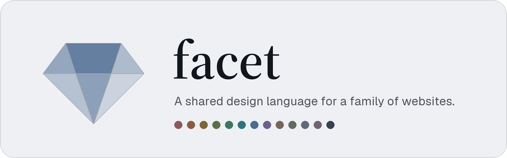
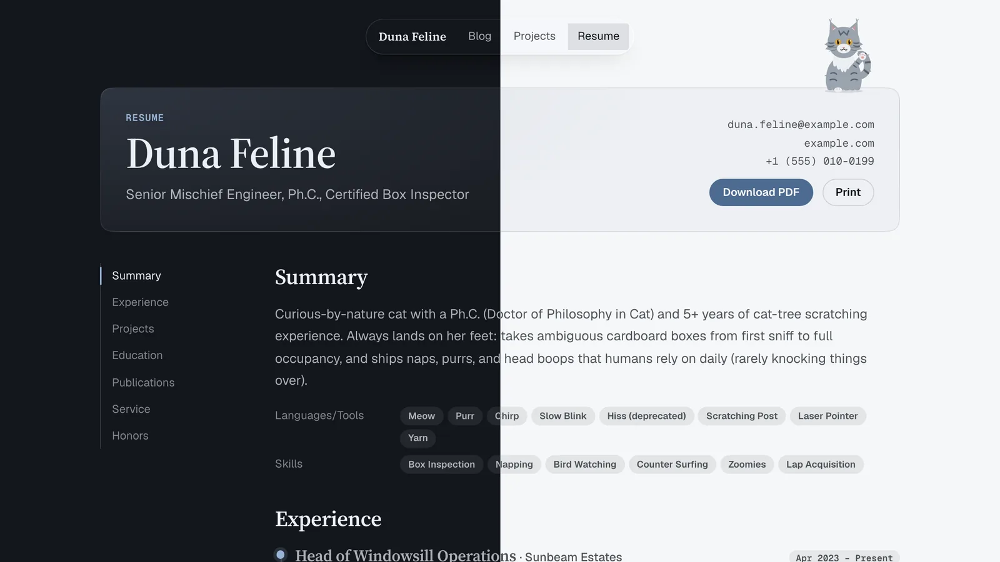
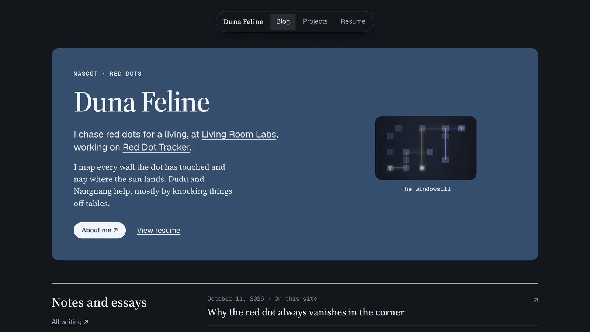
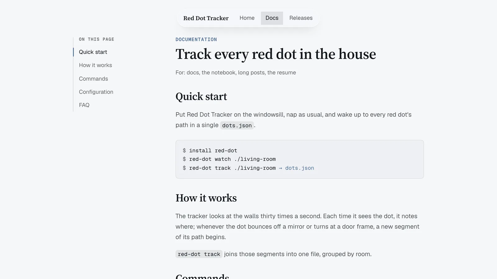
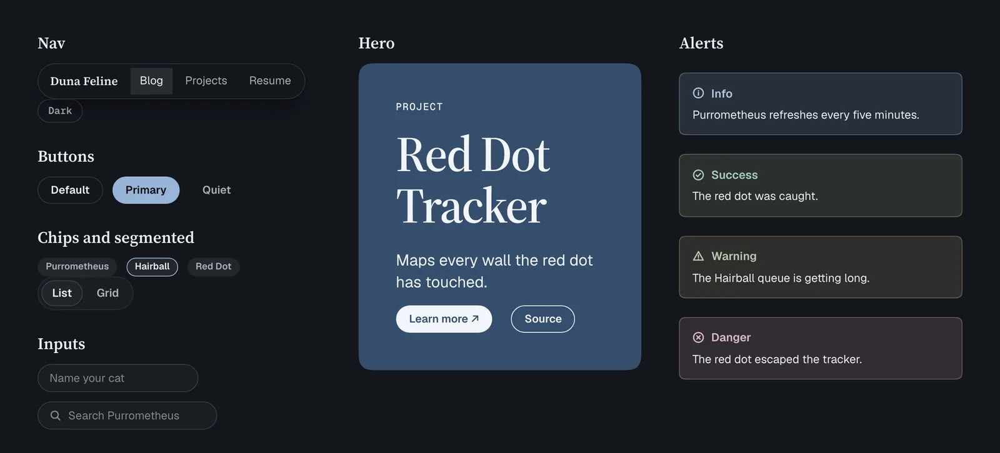
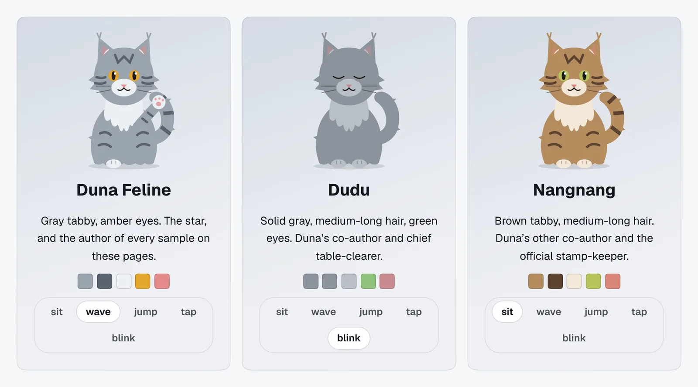

<picture>
  <source media="(prefers-color-scheme: dark)" srcset="assets/readme/banner-dark.png" />
  <source media="(prefers-color-scheme: light)" srcset="assets/readme/banner-light.png" />
  
</picture>

facet is a shared design language for a family of websites: design tokens, components and fifteen
page layouts in plain CSS and a little vanilla JavaScript, with no build step. Each site picks its
own accent and shares everything else, so every site is one facet of the same identity, cut from the
same glass. Dark-first with a full light theme, low in saturation, and bilingual in English and
Chinese.

**[Docs and live examples](https://shengtuo.me/facet/)** ·
[Layouts](https://shengtuo.me/facet/layouts/) ·
[Components](https://shengtuo.me/facet/components.html) ·
[Color](https://shengtuo.me/facet/color.html) · [Changelog](CHANGELOG.md)



<p>
  
  
</p>



<p align="center">
  
</p>

## Use it

Link the stylesheet and the optional script from jsDelivr, pinned to a tag, and pick an accent:

<!-- x-release-please-start-version -->

```html
<html lang="en" data-accent="moss">
  <head>
    <link rel="stylesheet" href="https://cdn.jsdelivr.net/gh/h1994st/facet@v0.1.9/dist/facet.css" />
    <script
      type="module"
      src="https://cdn.jsdelivr.net/gh/h1994st/facet@v0.1.9/dist/js/facet.js"
    ></script>
  </head>
  <body>
    <nav class="f-nav">…</nav>
    <main class="f-page f-prose">…</main>
  </body>
</html>
```

<!-- x-release-please-end -->

jsDelivr is unreliable in mainland China. For sites aimed there, vendor facet as a git submodule and
serve `vendor/facet/dist/` with the site:

<!-- x-release-please-start-version -->

```sh
git submodule add https://github.com/h1994st/facet vendor/facet
git -C vendor/facet checkout v0.1.9
```

<!-- x-release-please-end -->

The mascots, social icons, theme toggle, analytics and every other option are in the
[docs](https://shengtuo.me/facet/).

## Used by

- [The facet docs](https://shengtuo.me/facet/), the reference site in `site/`.
- [shengtuo.me](https://shengtuo.me/), a personal site.

## Develop

`brew bundle && uv sync` installs the tooling (`uv run playwright install chromium` adds the test
browser), `just serve` serves the docs and the design mockups at http://localhost:8000, and
`just test` runs the browser tests. `just` lists every recipe.

## Credits

The Focus layout, its typed address, and the Landing layout's hero card are inspired by
[mldangelo.com](https://mldangelo.com/) by Michael D'Angelo. The mascots are drawn as in the
my-resume template's site.

## License

MIT. Fonts keep their own licenses (SIL OFL).
